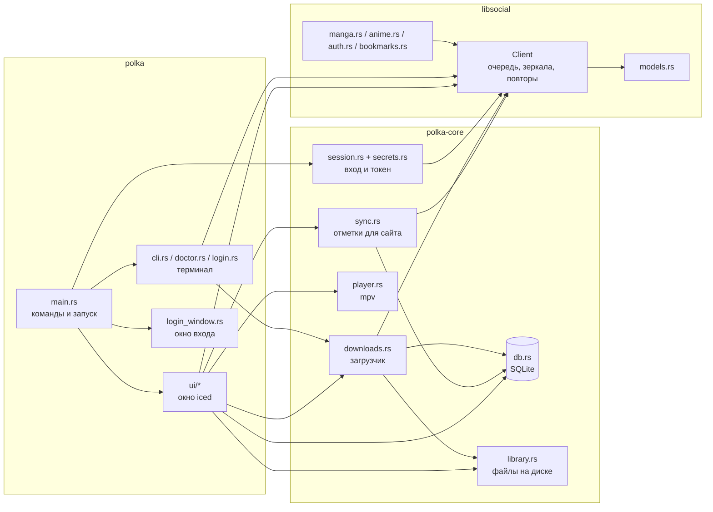
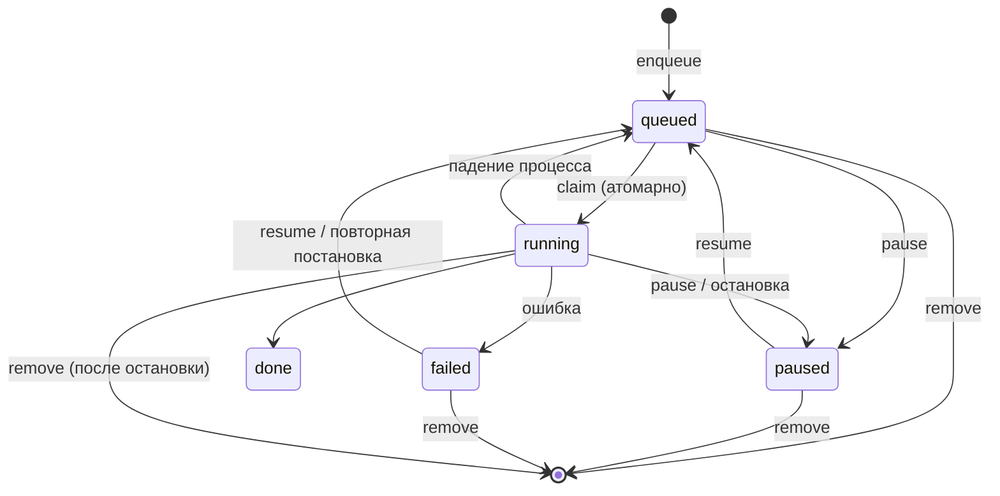

# Устройство Полки

Документ для тех, кто будет читать и менять код. Здесь описано, из чего состоит проект, как данные идут от сервера до экрана и на диск, какие гарантии держит каждая часть и почему некоторые решения выглядят странно. Как устроен сам сервис lib.social, разобрано отдельно в [api.md](api.md).

## Общая картина

Проект – cargo workspace из трёх крейтов.

| Крейт | Что это | Зависит от |
|---|---|---|
| `crates/libsocial` | Клиент API без интерфейса и без диска. Знает протокол сервиса, ходит в сеть аккуратно, разбирает ответы в типы. | reqwest, tokio, serde |
| `crates/polka-core` | Ядро приложения без интерфейса: база, загрузчик, библиотека на диске, синхронизация с аккаунтом, запуск плеера, вход. | libsocial, rusqlite, keyring, zip |
| `crates/polka` | Оболочка: окно на iced, окно входа на WebKitGTK, командная строка. | polka-core, iced, wry |

Интерфейс будет переписан на Slint. Поэтому всё, что не рисует, живёт в `polka-core`, а `polka` только показывает данные ядра и передаёт ему действия пользователя. Новый код, который не касается отрисовки, пишется в ядро.

Граница между `libsocial` и остальным проведена так, чтобы `libsocial` можно было взять в другой проект целиком. В нём нет ни путей на диске, ни SQLite, ни интерфейса. Всё, что приложение хочет знать о работе клиента (например, что токен обновился), оно узнаёт через колбэк `TokenListener`.



## libsocial

### Client

`Client` – центральный тип крейта. Он дёшево клонируется (внутри всё в `Arc`), и все клоны делят общее: токен, очередь запросов, текущее зеркало, кэш справочника, журнал недоступных серверов. Поэтому один `Client` создаётся при запуске и раздаётся всем, кому нужен.

Через `Client::send_api` идёт каждый запрос к API. Порядок такой:

1. `throttle()` ждёт своей очереди. Интервал между запросами задаётся `ClientConfig::api_interval`, по умолчанию 500 мс, то есть не больше двух запросов в секунду на весь процесс. Очередь общая для всех клонов.
2. Запрос собирается на текущем зеркале API. Замыкание `build` получает адрес зеркала, поэтому один и тот же запрос можно повторить на другом.
3. Если ответ похож на блокировку (HTML со статусом 200, 403 или 404, шлюз 502–504 или 52x) либо до зеркала не достучаться, клиент переходит на следующее зеркало без паузы. Настоящие ошибки API приходят в JSON, по этому признаку блокировка и отличается от честного 403. Если закрыты все зеркала, активным остаётся исходное, чтобы не запомнить последнее как рабочее. Когда на всех зеркалах лежит шлюз, лежит сам сервис: у зеркал один бекенд. Тогда запрос повторяется с паузами, как любой 5xx, и кончается `ServiceDown`, а не `Forbidden`, чтобы пользователь не решил, что его заблокировали.
4. На 401 при наличии токена клиент один раз обновляет токен и повторяет запрос.
5. На 429 и 5xx запрос повторяется до трёх раз с паузой 2, 4, 8 секунд или сколько велит `Retry-After`. Ответ 429 сдвигает общую очередь, поэтому притормаживают все запросы разом. Если `Retry-After` больше минуты, запрос внутри себя не ждёт: клиент сразу возвращает `RateLimited` и до конца паузы отказывает всем запросам к API, не отправляя их (`cooldown_remaining`).

Каждый проход цикла тратит одну из конечных попыток (смену зеркала, повтор, обновление токена), так что цикл всегда заканчивается. Это проверено тестами в `tests/client.rs`.

Запросы к серверам картинок и видео идут мимо очереди API (`fetch_bytes`, `fetch_stream`), потому что это серверы раздачи файлов, у них свои ограничения. Их параллельность ограничивает вызывающий код: загрузчик через `download_concurrency`, интерфейс через семафор в кэше картинок.

### Зеркала

`mirrors.rs` хранит три списка: зеркала API, серверы авторизации и домены сайтов. Порядок важен: первое рабочее зеркало клиент запоминает, приложение после удачного запроса сохраняет его в `~/.cache/polka/api-mirror` и при следующем запуске начинает с него (`Client::prefer_api`). Любой список можно заменить своим через `config.toml`.

Серверы картинок и видео в `mirrors.rs` не перечислены. Их присылает сам сервис в справочнике `/constants`. Клиент перебирает их по порядку, а сервер, который недавно не ответил, ставит в конец очереди на пять минут (`bad_hosts`, `order_by_health`). В журнал сервер попадает только из-за сетевого сбоя или 5xx: ответ 404 говорит только о конкретном файле.

### Вход и токен

`auth.rs` повторяет вход сайта: OAuth2 с PKCE, по умолчанию публичный веб-клиент `client_id=1`. Свой клиент и адрес возврата задаются в `ClientConfig` (`oauth_client_id`, `oauth_redirect_uri`), приложение берёт их из `config.toml`. Токен помнит, каким клиентом выдан (`Token::client_id`), и обновляется только им, поэтому смена клиента в настройках не ломает уже выполненный вход. `AuthSession` хранит секреты одной попытки входа (verifier и state) и строит адрес авторизации на каждом сервере авторизации. `extract_code` достаёт код из адреса возврата и сверяет state.

Правила обращения с токеном выстроены так, чтобы вход не терялся из-за временных сбоев:

- токен стирается только при `Error::RefreshRejected`, то есть когда сервер явно отверг refresh token (ответ 400 или 401 на обновление);
- сбой сети, упавший шлюз или закрытые зеркала токен не трогают;
- `restore_token` сначала ставит сохранённый токен и только потом пробует обновить его, поэтому запуск без сети не делает пользователя гостем;
- обновление идёт под `refresh_lock`: refresh token одноразовый, и два одновременных обновления сожгли бы его;
- запросы к эндпоинту токена (`Auth::TokenEndpoint`) не повторяются после отправки, иначе повтор после потерянного ответа израсходовал бы код или refresh token.

`Token` не печатается в логах: у него ручной `Debug`, который показывает только срок действия. То же у `ClientConfig`, где может лежать прокси с паролем.

### Модели

`models.rs` описывает ответы API. Сервер не строг к типам, поэтому разбор терпимый:

- поля, которые приходят то числом, то строкой, разбираются через `serde_util::*_lenient`;
- `null` вместо строки или списка превращается в значение по умолчанию (`null_default`);
- страница каталога (`Paged<T>`) выбрасывает элемент, который не удалось разобрать, вместо того чтобы падать целиком (`lenient_vec`);
- описание тайтла приходит то строкой, то документом редактора ProseMirror, иногда упакованным в строку. `TitleDetails::summary_text` разбирает все три случая.

Модели, которые приложение хранит на диске (карточка тайтла), сериализуются обратно, поэтому у них есть и `Serialize`.

### Ошибки

`Error` различает случаи, от которых зависит поведение вызывающего кода: `Unauthorized` (нужен вход), `RefreshRejected` (вход окончательно потерян), `Forbidden` (запрет или все зеркала закрыты), `NotFound`, `RangeUnsupported` и `RangeNotSatisfiable` (для докачки видео), `RateLimited` (сервис просит подождать дольше минуты), `ServiceDown` (шлюз перед сервисом отвечает 502–504 или 52x), `Network` (до сервера не достучаться). Всё остальное приходит как `Http` с кодом и началом тела ответа.

## polka-core и polka

Модули ниже, кроме `main.rs`, `cli.rs`, `doctor.rs`, `login.rs`, `login_window.rs` и `ui/`, лежат в `crates/polka-core/src`.

### Запуск

`main.rs` разбирает команду и создаёт рантайм tokio. Без команды запускается окно (`gui()`), с командой выполняется она: `login`, `logout`, `whoami`, `doctor`, `download`, `dev-get`.

Окно работает на двух рантаймах. iced исполняет задачи интерфейса на своём, а наш рантайм живёт всё время работы окна (`runtime.enter()`), и на нём крутится загрузчик. `reqwest::Client` общий и работает на обоих.

`session::connect` собирает `Client` с сохранённым входом: читает токен из хранилища, вешает слушатель, который сохраняет новые токены, и вспоминает рабочее зеркало.

### Хранение токена

`secrets.rs` кладёт токен в системное хранилище секретов (Secret Service: gnome-keyring, KWallet) под службой `polka`. Если хранилища нет, токен пишется в `~/.config/polka/token.json` с правами 0600 через временный файл, созданный с `create_new`.

### Окно входа

Сайт принимает возврат после входа только на свою страницу callback, а её скрипт сразу забирает код и уводит на главную. Поэтому `login_window.rs` открывает вход в своём окне на WebKitGTK (wry и tao) и перехватывает навигацию: как только окно собирается перейти на адрес callback, переход отменяется, код достаётся из адреса, окно закрывается.

GTK требует главный поток, а в окне приложения его занимает iced. Поэтому кнопка «Войти» запускает `polka login` отдельным процессом, а после его выхода читает новый токен из хранилища.

### База

`db.rs` хранит три таблицы в `~/.local/share/polka/polka.sqlite3`:

| Таблица | Ключ | Что в ней |
|---|---|---|
| `titles` | сайт, slug | карточка тайтла (JSON), обложка, флаг «в библиотеке» |
| `downloads` | сайт, slug, элемент | очередь загрузок: состояние, прогресс, путь, задание (JSON) |
| `progress` | сайт, slug, элемент | место чтения или просмотра, флаг «прочитано» |
| `outbox` | ключ отметки | отметки для сайта, которые ещё не отправлены |

Ключ элемента: `c{id главы}-b{id ветки или 0}` для главы и `e{id серии}` для серии. Прогресс серии не зависит от озвучки, поэтому в ключе нет плеера.

Схема меняется миграциями по `PRAGMA user_version`. Новая миграция дописывается в конец `MIGRATIONS`, старые не трогаются. Миграции идут под `BEGIN IMMEDIATE`, а версия читается уже под блокировкой, чтобы два процесса при первом запуске не мигрировали одновременно. База новее приложения не открывается.

Соединение одно, под `std::sync::Mutex`. Запросы короткие, а журнал WAL с `synchronous=NORMAL` не делает fsync на каждую запись, поэтому их зовут прямо из асинхронного кода. Тяжёлые пакетные операции (поставить в очередь сотни глав) идут одной транзакцией через `spawn_blocking`.

### Библиотека на диске

`library.rs` отвечает за раскладку файлов в `~/.local/share/polka/library`:

```text
<сайт>/<slug>/title.json                     карточка тайтла: библиотека работает без сети
<сайт>/<slug>/cover.jpg
<сайт>/<slug>/v1-c12-b3-1292692/0001.jpg     страницы главы: том, номер, ветка, id главы
<сайт>/<slug>/v1-c12-b3-1292692/chapter.json отметка, что глава скачана целиком
animelib/<slug>/s1-e3-p413938.mp4            серия: сезон, номер, озвучка
animelib/<slug>/s1-e3-p413938.vtt            субтитры рядом
export/<название>/<название> – Том 1.cbz     экспорт
```

В имени каталога главы есть её id, потому что на сайте бывают две разные главы с одинаковыми томом и номером. Все части имён проходят через `safe()`: она убирает разделители путей и ведущие точки, а длину режет по байтам (предел имени файла 255 байт, кириллица занимает по два).

Отметка `chapter.json` пишется последней. По ней читалка и экспорт понимают, что глава целая. Расширение страницы определяется по содержимому (`image_format`): сервер сжатия отдаёт JPEG под именем `.png`, и адресу верить нельзя.

### Загрузчик

`downloads.rs` берёт задания из таблицы `downloads` по одному и качает их на диск. Задание (`library::Job`) описывает, что качать: главу (том, номер, ветка) или серию (озвучка, качество). Ссылки на файлы в задании не хранятся, загрузчик получает их заново перед работой, потому что адреса видео живут недолго.



Как выполняется задание. Рабочий цикл (`run`) берёт из базы самое старое задание в очереди и запускает `process` в отдельной задаче tokio. `process` под замком `running` захватывает строку (`claim`), докачивает обложку тайтла (`ensure_cover`) и передаёт задание в `chapter` или `episode`. Итог (`Outcome::Done`, `Outcome::Stopped` или ошибка) превращается в `done`, `paused` или `failed`.

Глава (`chapter`):

1. Если в каталоге главы уже есть `chapter.json`, задание сразу готово.
2. Список страниц запрашивается заново (`chapter_pages_by`): адреса в задании не хранятся.
3. Страницы качаются параллельно, не больше `download_concurrency` за раз. Уже лежащая на диске страница пропускается (`find_page`). Перед каждой страницей проверяется флажок остановки: пауза и удаление действуют между страницами, начатая страница докачивается.
4. Каждая страница пишется через `.part` и переименование. Расширение берётся по содержимому, а ответ, который не картинка (страница блокировки со статусом 200), валит задание.
5. Последним пишется `chapter.json`. Ошибка любой страницы валит задание, уже скачанные страницы остаются для повтора.

Серия (`episode`):

1. Если файл серии уже есть, задание сразу готово. Поэтому всё, что должно лежать рядом с ним, надо скачать раньше видео.
2. Данные серии запрашиваются заново, в них ищется озвучка `player_id` с плеером Animelib. Пропала озвучка – ошибка с просьбой выбрать другую.
3. `resolve_video` выбирает качество и проверяет сервер запросом `Range: bytes=0-0`, при отказе берёт следующий.
4. Субтитры качаются до видео. Решение о сбое принимает `subtitle_missing`: 404, 403 и прочие 4xx, кроме 429, означают, что файла на сервере нет, и субтитры пропускаются с записью в журнал. Всё остальное (сеть, 5xx, 429 после повторов клиента) валит задание до начала видео, и повтор задания возьмёт их снова.
5. Сверяется `.part.json` с недокачанным куском, затем видео качается в `.part` (`stream_to`) с первого сервера и, при ошибке, с запасных. С `Range` сервер обязан ответить 206: ответ 200 означает, что докачка не поддерживается, кусок стирается, загрузка идёт с нуля. Ответ 416 значит, что кусок уже целый: процесс прервали перед переименованием.
6. Готовый `.part` переименовывается в файл серии, описание куска удаляется.

Гарантии загрузчика и как они обеспечены:

- Качает один процесс. Загрузчик держит блокировку файла `downloader.lock`. Второй процесс (например, `polka download` при открытом окне) только ставит задания в общую очередь. Когда первый процесс отпустит блокировку, второй заберёт очередь сам, проверяя её раз в 10 секунд.
- Очередь переживает перезапуск. При старте задания в состоянии `running` возвращаются в очередь (`requeue_interrupted`). Скачанные страницы повторно не качаются (`find_page`), а видео докачивается с места обрыва.
- Задание не захватить дважды. `Db::claim` переводит строку в `running` условным `UPDATE ... WHERE state = 'queued'`, и делается это под тем же замком `running`, которым пользуются пауза и удаление. Порядок захвата замков везде одинаковый: сначала `running`, потом база.
- Удаление не теряется. Итог задания и снятие отметки «выполняется» решаются под одним замком, поэтому запрос на удаление, пришедший во время работы, всегда выполнится.
- Недокачанное видео не склеивается с чужим. Рядом с `.part` лежит `.part.json` с путём файла на сервере (`href` из API) и качеством. Если при докачке они не совпадают, кусок выбрасывается. Кусок стирается и тогда, когда сервер не умеет докачивать (`RangeUnsupported`), но не из-за временных ошибок.
- Субтитры не теряются. Они качаются до видео: если файл серии уже готов, задание за ними не вернётся. Поэтому временный сбой валит задание, и повтор их докачает, а 404 и 403 (файла на сервере нет) серию не держат.
- Паника не убивает очередь. Каждое задание выполняется в своей задаче tokio, паника превращается в состояние `failed`.
- Зависшее соединение не держит очередь: на каждый кусок видео отведено 60 секунд.
- Просьба подождать задание не валит. Если API или сервер картинок ответил `RateLimited`, задание возвращается в очередь с объяснением в поле ошибки, а рабочий цикл спит столько, сколько просил сервис.
- Сервер не долбится. Между заданиями пауза 300 мс, после двух сбоев подряд пауза растёт от 5 секунд до 5 минут. Страницы главы качаются параллельно, не больше `download_concurrency` за раз.

Интерфейс узнаёт о ходе загрузок из канала `broadcast` (`DownloadEvent`). Если подписчик отстал и часть событий потерял, он перечитывает состояние из базы.

### Интерфейс

Окно написано на iced 0.14 по схеме Elm: состояние, сообщения, функция обновления, функция отрисовки.

`ui/mod.rs` содержит `App` и общий `Message`. Каждый экран – отдельный модуль со своим состоянием, своими сообщениями (`Msg`) и функциями `update` и `view`:

| Модуль | Экран |
|---|---|
| `catalog.rs` | каталог и поиск |
| `title.rs` | страница тайтла: главы или серии, скачивание, экспорт, запуск видео |
| `reader.rs` | читалка |
| `library_view.rs` | библиотека: папки закладок сайта и раздел «На устройстве» |
| `downloads_view.rs` | очередь загрузок |
| `settings.rs` | вход и настройки |
| `images.rs` | общий кэш картинок |
| `style.rs` | общие стили |

Экраны только рисуют и передают действия. Всё, что они показывают и решают, считает ядро, чтобы интерфейс на Slint взял это без переписывания:

| Модуль ядра | Что в нём |
|---|---|
| `Core` (`context.rs`) | клиент, база, библиотека, загрузчик, очередь отметок, настройки, вошедший пользователь и его папки |
| `title.rs` | загрузка тайтла и запасной вариант без сети (`load`, `offline`), `TitlePage`: ветки перевода, строки списков глав и серий с их состоянием, «Читать» и «Продолжить», отметки «прочитано», задания загрузчика, план экспорта, выбор плеера и команды |
| `reader.rs` | `ReaderSession`: откуда брать страницы главы, с какой страницы начать, запись места и отметок |

Экран сообщает приложению о том, что выходит за его рамки (открыть читалку, вернуться, показать сообщение), через перечисление `Effect`. Так `title.rs` не знает о существовании читалки, он только возвращает `Effect::Read`.

Общий `Ctx` раздаётся всем экранам: клиент, база, библиотека, загрузчик, настройки, хранилище токена.

#### Картинки

`images.rs` – самая хрупкая часть интерфейса, и вот почему.

В iced 0.14 размер картинки неизвестен, пока она не загружена в видеопамять. У картинки шириной во всё окно и высотой «по содержимому» высота получается нулевой, такую картинку никто не рисует, а значит, она так и не загружается. Поэтому каждая картинка после чтения проходит `iced::widget::image::allocate`, а показывается только размещённая. Размещение (`Allocation`) держит картинку в видеопамяти, пока жив объект.

Жизненный цикл картинки: `request` ставит загрузку (из дискового кэша, сети или файла) и запоминает ключ в `pending`, `finish` получает прочитанную картинку и отправляет её размещаться, а размещённую кладёт в `allocs`. Правила:

- результат принимается, только если его ждут: страница закрытой главы выбрасывается и в памяти не оседает;
- результаты загрузок принимает `App`, даже если экран, который их просил, уже закрыт, иначе ключ навсегда остался бы в ожидании;
- упавшая картинка сама не перезапрашивается, иначе каждый кадр читалки бил бы по серверу. Страницу повторяет кнопка в читалке, обложки снова грузятся после смены вкладки;
- обложек в видеопамяти не больше 400, старые выгружаются первыми, а страницы выгружаются при закрытии главы;
- в дисковый кэш (`~/.cache/polka/images`) попадают только настоящие картинки, испорченный файл удаляется. Кэш чистится до лимита из настроек при запуске.

#### Читалка

`reader.rs` показывает главу лентой (для вебтунов) или по одной странице. Страницы берутся с диска, если глава скачана целиком, иначе из сети. Грузится окно страниц вокруг текущей: одна до неё и пять после.

Текущая страница в ленте вычисляется по относительной прокрутке, поэтому место чтения запоминается приблизительно: высоты страниц до загрузки неизвестны. Глава считается прочитанной, когда пользователь дошёл до последней страницы. Флаг «прочитано» в базе не сбрасывается повторным открытием главы, снять его можно только явно.

Клавиши обрабатывает подписка `reader::keys`. В iced 0.14 функции, которые передаются в `Subscription::map` и `filter_map`, не должны ничего захватывать, поэтому везде используются обычные функции без замыканий.

### Закладки и отметки для сайта

С входом библиотека Полки – это закладки аккаунта. Вкладка «Библиотека» показывает папки сайта (`Ctx::folders`, загружаются после `/auth/me`), отдельно для манги и аниме, и раздел «На устройстве» с тайтлами из базы: добавленными без входа, со скачанным и с закладкой. На странице тайтла вместо кнопки «В библиотеку» выбирается папка. Если в закладке записано место, страница предлагает продолжить с него: своё место на этом устройстве при этом не перетирается.

Обратно на сайт уходят три вида отметок (`sync::Mark`):

- глава дочитана впервые (читалка, а также ручная отметка в списке);
- серия досмотрена впервые (слежение за mpv);
- место, где остановились: при смене главы и закрытии читалки, при закрытии плеера.

Отметка сначала пишется в таблицу `outbox`, потом фоновая задача `Sync` отправляет её через несколько секунд после появления и раз в минуту повторяет то, что не ушло. Поэтому главы, прочитанные без сети, тоже попадают в историю аккаунта. Ключ у места один на тайтл, так что уходит только последнее. Правила отправки:

- место пишется, только если тайтл уже в закладках: сама Полка закладок не заводит;
- если закладку меняли позже, чем появилась отметка (например, на телефоне), место не отправляется, чтобы не откатить чужой прогресс. На расхождение часов устройства и сервера отводится две минуты, а свою же недавнюю запись Полка помнит и за чужую не принимает;
- при недоступном сервисе или просьбе подождать отправка останавливается до следующего раза, отвергнутая сервисом отметка (404, 422) выбрасывается. Отметка, на которую сервис отвечает 403 или 500, уходит в конец очереди и выбрасывается после 20 попыток;
- снять отметку «прочитано» на сайте нельзя, поэтому снятие в Полке остаётся только на этом устройстве.

### Видео

`player.rs` запускает mpv: сервер видео требует заголовок `Referer` сайта, а mpv умеет его передать. Адрес передаётся после `--`, чтобы строка с сервера не превратилась в опцию mpv. Скачанная серия без mpv открывается в плеере по умолчанию.

Позицию просмотра mpv отдаёт через свой IPC-сокет (`--input-ipc-server`, сокет в `$XDG_RUNTIME_DIR`). `Playback::track` подписывается на `time-pos` и `duration`, раз в 10 секунд и при закрытии плеера пишет позицию в таблицу `progress`. Серия считается просмотренной, когда позади 90%. Следующий запуск продолжает с записанной секунды, досмотренная серия открывается с начала. После закрытия плеера страница тайтла перечитывает прогресс (`Msg::PlaybackEnded`). У плеера по умолчанию сокета нет, там позиция не записывается.

## Тесты

| Где | Что проверяет | Сеть |
|---|---|---|
| `libsocial/src/**` (`#[cfg(test)]`) | PKCE, разбор адреса возврата, сроки токена, параметры каталога, зеркала | нет |
| `libsocial/tests/fixtures.rs` | разбор настоящих ответов API из `tests/fixtures`; закладки разбираются по синтетическим ответам с устройством настоящих, без данных аккаунта | нет |
| `libsocial/tests/client.rs` | смена зеркал, повторы, обновление токена, запасной сервер картинок на мок-сервере wiremock | нет |
| `libsocial/tests/live.rs` | те же сценарии против настоящего API, помечены `#[ignore]` | да |
| `polka-core/src/**` (`#[cfg(test)]`) | очередь в базе, прогресс, пути и имена файлов, CBZ, блокировка загрузчика, удаление файлов серии, позиция просмотра из сокета mpv, отправка отметок на мок-сервер (`sync.rs`) | нет |
| `polka-core/src/downloads.rs` (`job_tests`) | задания загрузчика целиком на wiremock: глава, пауза и продолжение, удаление на ходу, второй процесс, докачка видео, чужой `.part`, сервер без докачки, 416, субтитры | нет |

### Тесты загрузчика

`job_tests` в `downloads.rs` гоняют настоящий `Downloader` с настоящей базой (`Db::in_memory`) и библиотекой во временном каталоге. Один `MockServer` из wiremock изображает сразу API (`/api/...`), сервер картинок (`/img`) и сервер видео (`/video`): справочник `/api/constants` указывает на тот же сервер. Клиент создаётся с `api_interval: Duration::ZERO`, чтобы очередь API не тормозила тесты.

Как они устроены:

- `env()` поднимает мок-сервер, справочник и загрузчик с одной картинкой за раз и проверяет, что загрузчик взял блокировку. Каталог стирается в `Drop`.
- `mount_chapter` и `mount_episode` монтируют ответы для главы и серии. Страницы главы – JPEG по адресу с `.png`, как у сервера сжатия. С флажком `once` каждая страница должна быть запрошена ровно один раз, это проверяет `server.verify()`.
- Результат ждут по базе, а не по событиям: `wait_for` и `wait_state` опрашивают строку очереди каждые 20 мс до 30 секунд. Так тест не зависит от того, успел ли он подписаться на канал.
- Пауза и удаление на ходу проверяются на страницах с задержкой 300 мс: команда приходит, когда задание уже в `running` и знает число страниц, то есть посреди главы.
- `video_ranges` достаёт из журнала мок-сервера заголовки `Range` запросов к видео без проверочного `bytes=0-0`. По нему видно, докачивал ли загрузчик или начал с нуля.
- `subtitles_failure_is_retried_with_job` идёт около 15 секунд: клиент повторяет ответ 500 с паузами 2, 4 и 8 секунд. Подменять время через `tokio::time::pause` нельзя: таймауты reqwest и загрузчика сработают раньше ответов сервера.

Новый сценарий загрузчика добавляется туда же: смонтировать ответы, поставить задание через `enqueue`, дождаться состояния и проверить файлы на диске.

Фикстуры сняты с настоящего API. Поля просмотра пользователя и ники загрузчиков глав в них заменены.

## Проверка интерфейса без мыши

Для отладки окно умеет открываться сразу на нужном экране:

```sh
POLKA_DEV_OPEN=mangalib:7965--chainsaw-man polka      # страница тайтла
POLKA_DEV_OPEN=mangalib:7965--chainsaw-man:0 polka    # и первая глава в списке
POLKA_DEV_TAB=downloads polka                         # вкладка
POLKA_DEBUG=1 polka                                   # журнал загрузки картинок в stderr
```

Чтобы не трогать свою библиотеку, запускайте с отдельными каталогами: `XDG_DATA_HOME`, `XDG_CACHE_HOME`, `XDG_CONFIG_HOME`. Токен при этом берётся из системного хранилища, так что вход сохраняется.

## Куда смотреть, если надо

| Задача | Файл |
|---|---|
| Новый эндпоинт API | `libsocial/src/manga.rs` или `anime.rs`, модель в `models.rs`, фикстура и тест в `tests/fixtures.rs` |
| Зеркало перестало работать | `libsocial/src/mirrors.rs` |
| Новое поле в базе | новая строка в `MIGRATIONS` в `polka-core/src/db.rs` |
| Новый тип загрузки | вариант `Job` в `library.rs`, ветка в `Downloader::process`, сценарии в `job_tests` в `downloads.rs` |
| Новый экран | модуль в `ui/`, вариант в `Message`, ветка в `App::update` и `App::view` |
