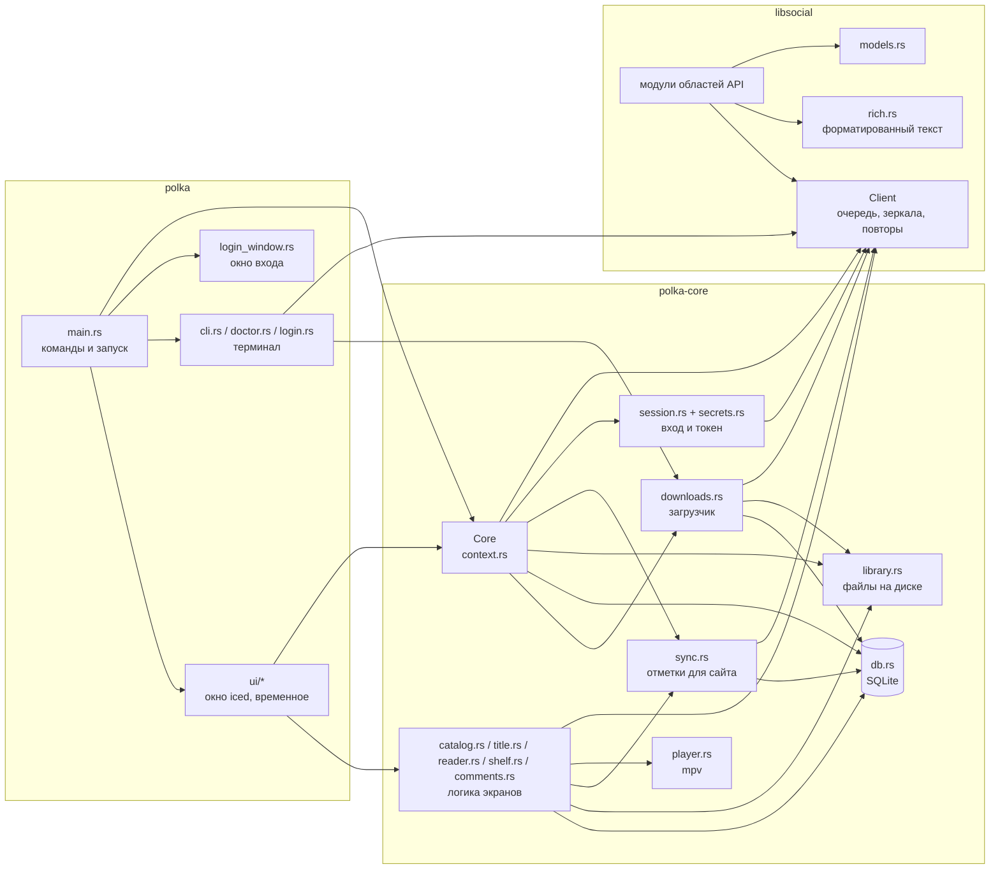
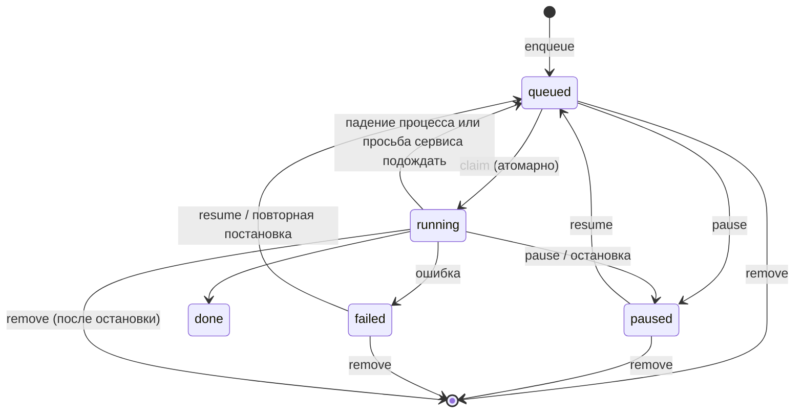

# Устройство Полки

Документ для тех, кто будет читать и менять код. Здесь описано, из чего состоит проект, как данные идут от сервера до экрана и на диск, какие гарантии держит каждая часть и почему некоторые решения выглядят странно. Как устроен сам сервис lib.social, разобрано в [api.md](api.md). Что уже сделано и что делать дальше, сведено в [roadmap.md](roadmap.md).

## Общая картина

Проект – cargo workspace из трёх крейтов.

| Крейт | Что это | Зависит от |
|---|---|---|
| `crates/libsocial` | Клиент API без интерфейса и без диска. Знает протокол сервиса, ходит в сеть аккуратно, разбирает ответы в типы. | reqwest, tokio, serde |
| `crates/polka-core` | Ядро приложения без интерфейса: база, загрузчик, библиотека на диске, синхронизация с аккаунтом, логика экранов, запуск плеера, вход. | libsocial, rusqlite, keyring, zip |
| `crates/polka` | Оболочка: окно на iced, окно входа на WebKitGTK, командная строка. | polka-core, iced, wry |

Интерфейс будет переписан на Slint. Поэтому всё, что не рисует, живёт в `polka-core`, а `polka` только показывает данные ядра и передаёт ему действия пользователя. Правило для нового кода: если его можно написать без виджетов, он пишется в ядро. Окно iced сейчас временное: оно умеет меньше, чем клиент API и ядро, и новые возможности в него больше не добавляются (см. [roadmap.md](roadmap.md)).

Граница между `libsocial` и остальным проведена так, чтобы `libsocial` можно было взять в другой проект целиком. В нём нет ни путей на диске, ни SQLite, ни интерфейса, ни состояния, кроме сетевого (токен, очередь, зеркала, справочник). Всё, что приложение хочет знать о работе клиента (например, что токен обновился), оно узнаёт через колбэк `TokenListener`.



## libsocial

### Client

`Client` – центральный тип крейта. Он дёшево клонируется (внутри всё в `Arc`), и все клоны делят общее: токен, очередь запросов, текущее зеркало, кэш справочника, журнал недоступных серверов, паузу, о которой попросил сервис. Поэтому один `Client` создаётся при запуске и раздаётся всем, кому нужен.

Через `Client::send_api` идёт каждый запрос к API. Порядок такой:

1. Если сервис раньше попросил подождать дольше минуты и пауза не кончилась, запрос сразу возвращает `Error::RateLimited` и в сеть не уходит (`cooldown_remaining`).
2. `throttle()` ждёт своей очереди. Интервал между запросами задаётся `ClientConfig::api_interval`, по умолчанию 500 мс, то есть не больше двух запросов в секунду на весь процесс. Очередь общая для всех клонов.
3. Запрос собирается на текущем зеркале API. Замыкание `build` получает адрес зеркала, поэтому один и тот же запрос можно повторить на другом.
4. Если ответ похож на блокировку (HTML со статусом 200, 403 или 404, шлюз 502–504 или 52x) либо до зеркала не достучаться, клиент переходит на следующее зеркало без паузы. Настоящие ошибки API приходят в JSON, по этому признаку блокировка и отличается от честного 403. Если закрыты все зеркала, активным остаётся исходное, чтобы не запомнить последнее как рабочее. Когда на всех зеркалах лежит шлюз, лежит сам сервис: у зеркал один бекенд. Тогда запрос повторяется с паузами, как любой 5xx, и кончается `ServiceDown`, а не `Forbidden`, чтобы пользователь не решил, что его заблокировали.
5. На 401 при наличии токена клиент один раз обновляет токен и повторяет запрос.
6. На 429 и 5xx запрос повторяется до трёх раз с паузой 2, 4, 8 секунд или сколько велит `Retry-After`. Ответ 429 сдвигает общую очередь, поэтому притормаживают все запросы разом. Если `Retry-After` больше минуты, запрос внутри себя не ждёт: клиент заводит паузу (пункт 1) и сразу возвращает `RateLimited`.

Каждый проход цикла тратит одну из конечных попыток (смену зеркала, повтор, обновление токена), так что цикл всегда заканчивается. Это проверено тестами в `tests/client.rs`.

Таймауты клиента: подключение 10 секунд, обычный запрос 60 секунд, потоковая загрузка видео 6 часов. Клиент представляется честно: `User-Agent: Polka/{версия} (unofficial lib.social client; +адрес репозитория)`. Справочник `/constants` (адреса серверов картинок и видео) кэшируется на время жизни клиента, а после неудачи 30 секунд не перезапрашивается. Для отладки есть `raw_get` (сырой ответ, им пользуется `polka dev-get`) и `probe_url` (проверка, что файл отдаётся, одним байтом).

Запросы к серверам картинок и видео идут мимо очереди API (`fetch_bytes`, `fetch_stream`), потому что это серверы раздачи файлов, у них свои ограничения. Их параллельность ограничивает вызывающий код: загрузчик через `download_concurrency`, интерфейс через семафор в кэше картинок. `Retry-After` до минуты `fetch_bytes` выжидает, дольше – возвращает `RateLimited`.

### Как пишутся запросы

Модули областей API не собирают запросы руками, а зовут общие `pub(crate)` методы `Client`:

| Метод | Для чего |
|---|---|
| `get_data(site, path, &query)` | GET с разбором `{"data": T}` |
| `get_json(site, path, &query)` | GET с разбором всего тела: когда рядом с `data` нужны `meta` и `links` или обёртки нет |
| `send_data(site, Method, path, &query, Some(&body))` | запрос с телом JSON и разбором `{"data": T}` |
| `send_ok(site, Method, path, Some(&body))` | запрос, ответ которого не нужен |
| `send_raw(site, Method, path, &query, body)` | ответ целиком: тело без обёртки `data` или двоичное |
| `send_record(site, Method, path, Some(&body))` | запись, ответ которой – одна запись с обёрткой `data` или без; ответ без записи даёт `None`, чтобы запрос не повторили |
| `send_api(Auth::User, \|http, base\| …)` | особые случаи: multipart, свои заголовки |
| `get_page` (в `listing.rs`) | GET списка, понимает четыре формы пагинации |

Отдельных обёрток под сайт не заводят: сайт – это аргумент `Site`, и ранобэ ходит теми же методами с `Site::RanobeLib`. `path` пишется без `/api` и без ведущей косой. `Site` определяет заголовки `Site-Id`, `Referer` и `Origin` (`Client::site_headers`). Если ответ от сайта не зависит (комментарии, уведомления, карточки), берётся `Site::MangaLib`. Метод `update` в скриптах сайта – это PUT (так написано в HTTP-клиенте сайта), и клиент везде шлёт PUT.

### Сайты

`Site` перечисляет пять сайтов сети: MangaLib (1), SlashLib (2), RanobeLib (3), HentaiLib (4), AnimeLib (5). У каждого есть `id` для `Site-Id`, домен для `Referer` и `Origin`, ключ для путей на диске (`mangalib`, `ranobelib`...), раздел каталога (`catalog_path`: `anime` у AnimeLib, у остальных `manga`) и признаки `is_anime` и `is_ranobe`. RanobeLib появился последним: главы у него текстом, поэтому окно iced его не показывает (ни в каталоге, ни в папках библиотеки), а загрузчик (`Downloader::enqueue`) и `polka download` отказываются его качать, пока не написано задание для текста.

### Зеркала

`mirrors.rs` хранит три списка: зеркала API, серверы авторизации и домены сайтов. Порядок важен: первое рабочее зеркало клиент запоминает, приложение после удачного запроса сохраняет его в `~/.cache/polka/api-mirror` и при следующем запуске начинает с него (`Client::prefer_api`). Зеркала API и серверы авторизации можно заменить своими через `config.toml` (`api_mirrors`, `auth_mirrors`); домены сайтов зашиты в код.

Серверы картинок и видео в `mirrors.rs` не перечислены. Их присылает сам сервис в справочнике `/constants`. Клиент перебирает их по порядку, а сервер, который недавно не ответил, ставит в конец очереди на пять минут (`bad_hosts`, `order_by_health`). В журнал сервер попадает из-за сетевого сбоя, 5xx или 429 после исчерпанных повторов: ответ 404 говорит только о конкретном файле. У озвучки манги свои серверы видео (`videoServersManga`).

### Вход и токен

`auth.rs` повторяет вход сайта: OAuth2 с PKCE, по умолчанию публичный веб-клиент `client_id=1`. Свой клиент и адрес возврата задаются в `ClientConfig` (`oauth_client_id`, `oauth_redirect_uri`), приложение берёт их из `config.toml`. Токен помнит, каким клиентом выдан (`Token::client_id`), и обновляется только им, поэтому смена клиента в настройках не ломает уже выполненный вход. У токенов, сохранённых до появления поля, это веб-клиент. `AuthSession` хранит секреты одной попытки входа (verifier и state) и строит адрес авторизации на каждом сервере авторизации. `extract_code` достаёт код из адреса возврата и сверяет state.

Правила обращения с токеном выстроены так, чтобы вход не терялся из-за временных сбоев:

- токен стирается только тогда, когда сервер явно отверг вход: на обновление пришёл отказ 400 или 401 (`Error::RefreshRejected`) или на запрос пришёл 401, а refresh token у токена нет и обновить его нечем. Кроме того, его стирает выход;
- сбой сети, упавший шлюз, закрытые зеркала и просьба подождать токен не трогают;
- `restore_token` сначала ставит сохранённый токен и только потом пробует обновить его, поэтому запуск без сети не делает пользователя гостем;
- обновление идёт под `refresh_lock`: refresh token одноразовый, и два одновременных обновления сожгли бы его;
- запросы к эндпоинту токена (`Auth::TokenEndpoint`) не повторяются после отправки, иначе повтор после потерянного ответа израсходовал бы код или refresh token;
- выход (`Client::logout`) сбрасывает токен сразу, а потом отзывает его запросом `Auth::Revoke`: токен передаётся в запрос явно, обновления на 401 и повторов нет, чтобы выход не ждал лежащий сервер.

`Token` не печатается в логах: у него ручной `Debug`, который показывает только срок действия и клиент. То же у `ClientConfig`, где может лежать прокси с паролем.

### Модели и терпимый разбор

`models.rs` описывает общие ответы API (тайтл, глава, ветка, плеер, справочник). Модели отдельных областей лежат в модулях этих областей. Сервер не строг к типам, поэтому разбор терпимый:

- поля, которые приходят то числом, то строкой, разбираются через `serde_util` (`u64_lenient`, `opt_u64_lenient`, `string_lenient`, `opt_string_lenient`, `f32_lenient`, `opt_f32_lenient`) и `listing` (`bool_lenient`, `site_ids_lenient`);
- вложенный объект, без которого элемент списка обойдётся (`userBookmark` в карточке каталога, `media` и `item` у закладки), разбирается через `opt_lenient`: если он не подошёл под тип, поле становится `None`, а не роняет весь элемент. Будьте осторожны с `#[serde(default)]` у обязательных полей такого объекта: именно обязательное поле отличает испорченный объект от настоящего;
- `null` вместо строки или списка превращается в значение по умолчанию (`null_default`);
- элемент списка, который не удалось разобрать, выбрасывается, а не валит страницу (`lenient_vec`);
- непонятные или большие объекты, которые пока не нужны целиком, держатся как `serde_json::Value`;
- модели, которые приложение хранит на диске (карточка тайтла), сериализуются обратно, поэтому у них есть и `Serialize`.

Списки сервиса пагинируются четырьмя способами: курсором (`links.next`, иногда `meta.has_next_page` или булев `meta.next_page_url`), номерами (`current_page`, `last_page`, `total`), вовсе без `meta` и `links` (весь список за раз) и плоским пагинатором Laravel у форума (номера и адрес `next_page_url` лежат на верхнем уровне ответа рядом с `data`, а `links` – массив кнопок). Число `Page` берёт из `meta`, а если его там нет, с верхнего уровня. Все они разбираются в один тип `listing::Page<T>`: `items`, `has_next`, `total`, `page`, `per_page`, `last_page` и `meta` ответа целиком. В `meta` остаётся то, что у списка своё: курсор случайного порядка каталога (`RandomCursor::of`), фильтры и лимиты карточек. `Page` разбирается прямо из ответа (`Deserialize`), метод клиента для списка зовёт `get_page`; тип вынесен в корень крейта как `libsocial::Page`. Дерево комментариев в `Page` не укладывается, признак следующей страницы оно берёт у `listing::has_next`.

### Форматированный текст

Сервис присылает форматированный текст в трёх видах: HTML (комментарии, старые главы ранобэ), документ редактора ProseMirror (описания тайтлов, людей и команд, отзывы, новости, новые главы ранобэ, уведомления, новые темы форума), иногда упакованный в строку, и документ редактора Quill (старые темы форума). Отправляет клиент только ProseMirror.

`rich.rs` сводит всё к одной модели `Doc`: последовательность блоков (`Paragraph`, `Heading`, `Quote`, `Spoiler`, `List`, `Images`, `Sticker`, `TitleCard`, `Rule`) со строчными элементами (`Text` с оформлением `Marks`: жирный, курсив, подчёркнутый, зачёркнутый, ссылка; `Break`; строчный `Spoiler`; `Timecode` с секундами; `Image`). Интерфейс рисует `Doc` и не разбирает форматы сам.

- `Doc::from_html` – терпимый разбор: незакрытые теги закрываются, лишние закрывающие пропускаются, `<p>` внутри `<p>` закрывает абзац, скрипты и стили выбрасываются, сущности `&amp;` и `&#…;` раскрываются. Знает спойлеры трёх видов (старый `comment__spoiler`, `mark-spoiler`, новый `spoiler-node`), картинки с превью и оригиналом, стикеры, карточки тайтлов, таймкоды серий.
- `Doc::from_prosemirror` – узлы `paragraph`, `heading`, `blockquote`, `spoilerBlock`, `spoilerInline`, списки, `horizontalRule`, `image` (одна картинка или галерея), `sticker`, `titleAttachment`, метки оформления и `timecode`. Неизвестный узел отдаёт хотя бы свой текст.
- `Doc::from_quill` – документ Quill `{"ops": […]}`: строки по переводам строк, оформление строки (заголовок, список, цитата) из атрибутов перевода строки, соседние строки списка или цитаты сливаются в один блок, пустые строки блоками не становятся; строчное оформление и ссылки, картинки-вставки.
- `Doc::to_prosemirror` – обратно для отправки. Блоки картинок, стикеров и карточек тайтлов он пропускает: серверу нужны имена загруженных файлов и данные карточки, а не адреса. Картинки и стикер в отправляемый комментарий добавляет `post_comment` из `NewComment::images` и `sticker`, картинки темы форума – `NewDiscussion::images`; карточку тайтла в комментарий клиент пока вставлять не умеет. Таймкод уходит обычным текстом: плеера и команды для метки модель не хранит.
- `Doc::from_plain` и `plain_text` – переход от простого текста и обратно.

Чего `Doc` не хранит, известно: номеров абзацев ранобэ (их держит `RanobeChapter::spans` параллельно блокам), выравнивания, подписей картинок, сносок. Если понадобится, модель расширяется, а не обходится.

### Карта модулей

| Модуль | Область | Главное |
|---|---|---|
| `client.rs` | очередь, зеркала, повторы, файлы | `Client`, `ClientConfig`, `fetch_bytes`, `fetch_stream`, `constants`, `cooldown_remaining` |
| `auth.rs` | вход OAuth с PKCE | `AuthSession`, `Token`, `begin_login`, `exchange_code`, `refresh_token`, `restore_token`, `me` |
| `site.rs`, `mirrors.rs` | сайты сети и зеркала | `Site`, `mirrors::web` |
| `models.rs` | общие модели | `TitleShort` (с закладкой пользователя, пометками о содержании, оценкой Shikimori), `TitleDetails` (с фоном, просмотрами, издателями, франшизой, метаданными, числом глав, оценкой перевода, данными аниме), `Chapter`, `ChapterBranch`, `ChapterPages` (лайк, оценка перевода, закрытость), `Branch` (подписка), `Player` (таймкоды, отметка просмотра), `Rating` (своя оценка) |
| `manga.rs` | тайтл, главы, страницы | `title`, `chapters`, `branches`, `chapter_pages_by`, `fetch_page` |
| `anime.rs` | серии и видео | `episodes`, `episode`, `resolve_video` |
| `bookmarks.rs` | папки, закладки, отметки о прочтении | `BookmarkFolder` и `Bookmark` со всеми полями сервера, `bookmark_folders`, `bookmark`, `set_bookmark`, `delete_bookmark`, `mark_chapter_viewed`, `mark_episode_viewed`, `format_timecode` |
| `bookmarks_ext.rs` | всё остальное о закладках | список (`bookmark_list`) с сортировками и поиском, папки (создать, изменить, удалить с переносом, порядок, уведомления), массовые операции, заметки к главам, комментарий и пересмотры |
| `forum.rs` | форум | `ForumCategory` и `forum_categories`, список тем `discussions` с фильтром `DiscussionQuery` (раздел, свои темы, подписки, поиск, автор, тайтл или команда `DiscussionSource`), `sticky_discussions`, тема целиком `discussion` (`DiscussionDetails`: текст в `Doc` из любого из трёх видов, картинки с полным адресом, связь с тайтлом), `create_discussion`, `edit_discussion` (`NewDiscussion`), `toggle_discussion_subscription`, `like_discussion`, `upload_discussion_images`; действия модератора не входят |
| `faq.rs` | справка | `faq_categories`, `faq_articles`, `faq_article` (картинки с полным адресом) |
| `reports.rs` | жалобы и тикеты | `ReportTarget` (пользователь, подборка, отзыв, карточка, тема, глава, серия), `ReportType`, `report_reasons_for`, `report`; ошибка в карточке тайтла `TitleTicket`, `report_title_error` |
| `comments.rs` | комментарии | `Target` (к чему комментарий, в том числе страница главы), `comments`, `comment_thread`, `sticky_comments`, `post_comment`, `edit_comment`, `delete_comment`, `vote`, `report_comment`, `report_types`, `sticker_packs`, `upload_comment_images` (загрузка общая с картинками темы форума), `user_comments`, подписка на новые комментарии (`CommentWatch`, `comment_subscription`, `toggle_comment_subscription`) |
| `media.rs` | вокруг тайтла | `covers`, `title_stats`, `relations`, `similar` и голоса, `add_similar`, `title_characters`, звёздочки-подписки и избранное списком (`favorites_list`, `favorites_bulk`), `rate_title`, `like_chapter`, `rate_translation`, подписки на ветку и озвучку, команды и их оценка, игнор команды, отзывы целиком, озвучка манги (список и `manga_voice`) |
| `catalog.rs`, `catalog_constants.rs` | полный каталог и справочник формы | `CatalogFilter` со всеми параметрами, `CatalogSort`, случайный порядок с курсором, отказ до запроса там, где сервер ответил бы 422; `catalog_constants` с отбором по сайту и видами тикетов об ошибке в карточке |
| `feeds.rs` | главная и ленты | `home`, `latest_updates`, `user_latest_updates`, `top_views`, `hot_newest`, `news`, `news_article`, `mark_news_visited`, `upload_url` |
| `search.rs` | поиск сущностей и пользователей | `EntityKind`, `EntityCard`, `search_entities`, `entity`, `users` |
| `notifications.rs` | уведомления | счётчики, список с типизированными событиями `NotificationEvent`, отметка прочитанным и удаление поштучно и пачкой |
| `users.rs` | профиль и настройки | `user_profile`, `user_stats`, `user_view_statistics`, `view_history` (три вида), настройки приватности, уведомлений, фильтра контента и персонализации на чтение и запись; что пользователь залил (`UploadState`, `uploaded_chapters`, `uploaded_characters`, `uploaded_cards`), `premium_status`; правка профиля (`ProfileInfo`, `update_profile_info`, `change_email`, `send_email_confirmation`, `upload_avatar`, `upload_background`, `delete_profile`, `unlink_oauth`) |
| `social.rs` | друзья, игнор, сообщения | списки друзей и заявок, общие друзья, заявки в друзья (отправить, принять, отклонить, удалить), массовое принятие и отклонение, игнор-лист, диалоги и сообщения, проверка онлайна |
| `collections.rs` | подборки | список с фильтрами, одна подборка, свои и избранные, создание, правка, удаление, голос |
| `ranobe.rs` | текст глав ранобэ | `RanobeChapter` (оба вида текста в `Doc`, картинки с верными адресами, номера абзацев, место для закладки), `ranobe_chapter`; список глав и ветки отдают общие `chapters` и `branches` с `Site::RanobeLib` |
| `exports.rs` | серверный экспорт книг (EPUB, FB2, MOBI – какие доступны, говорит `book_export_settings`; только премиум) | создание задачи, опрос по `poll_after` (`wait_book_export`), скачивание по сегментам и ссылкам (`download_book_export`) |
| `cards.rs` | коллекционные карточки | каталог, карта, владельцы, инвентарь, папки, статистика, альбомы и награды, коллекция и осколки по тайтлу, рынок, лоты, заявки, прямые обмены, хаос-обмен, топ, просмотр паков; действия с ними, кроме платных (покупки и открытия паков нет), история карт (`card_history_options`, `user_card_history`, `card_instance_history`) |
| `rich.rs` | форматированный текст | `Doc` и всё выше |
| `listing.rs` | общее для списков | `Page` (страница любого списка), `SortOrder`, `get_page`, терпимые разборщики булевых значений и списков сайтов |
| `serde_util.rs` | терпимый разбор | `*_lenient`, `opt_lenient`, `null_default`, `lenient_vec` |
| `error.rs` | ошибки | `Error`, `Result` |

Какие запросы за этим стоят и какие у них ловушки, расписано в [api.md](api.md) по тем же областям.

### Ошибки

`Error` различает случаи, от которых зависит поведение вызывающего кода: `Unauthorized` (нужен вход), `RefreshRejected` (вход окончательно потерян), `Forbidden` (запрет или все зеркала закрыты), `NotFound`, `RangeUnsupported` и `RangeNotSatisfiable` (для докачки видео), `RateLimited { retry_after }` (сервис просит подождать дольше минуты), `ServiceDown { status }` (шлюз перед сервисом отвечает 502–504 или 52x), `Network` (до сервера не достучаться), `Decode` (ответ не разобрался), `Auth` (отказ при входе). Всё остальное приходит как `Http` с кодом и началом тела ответа. Некоторые модули отказывают до запроса через `Error::Other`, если сервер точно ответил бы 422 (чужая сортировка каталога, слишком короткий поиск, слишком длинное сообщение).

## polka-core

### Core

`Core` (`context.rs`) – ядро целиком: клиент, база, библиотека на диске, загрузчик, очередь отметок, настройки, хранилище токена, id вошедшего пользователя и его папки закладок. Клонируется дёшево. Оболочка создаёт его один раз:

```rust
let core = runtime.block_on(polka_core::Core::start(config))?;
```

`Core::folders_for(site)` отдаёт папки закладок для сайта. `Core::start` поднимает сохранённый вход (`session::connect`), открывает базу, запускает загрузчик и отправку отметок. Звать его надо внутри рантайма tokio, который живёт всё время работы приложения: на нём крутятся загрузчик и отправка. `user_id` и `folders` заполняет оболочка после ответа `/auth/me` и `bookmark_folders`. Для тестов есть `Core::for_tests(dir, api)` с базой в памяти и сервером по адресу мок-сервера.

### Карта модулей ядра

| Модуль | Что в нём |
|---|---|
| `context.rs` | `Core` |
| `config.rs` | настройки и пути по XDG (ниже таблица) |
| `session.rs`, `secrets.rs` | клиент с сохранённым входом, завершение входа (`complete_login`), хранение токена |
| `db.rs` | SQLite: тайтлы, очередь загрузок, прогресс, очередь отметок |
| `library.rs` | раскладка файлов, задания загрузчика (`Job`), экспорт CBZ |
| `downloads.rs` | загрузчик |
| `sync.rs` | отметки для сайта: прочтение, просмотр, место в закладке |
| `player.rs` | mpv: запуск, позиция через IPC, пропуск опенинга |
| `catalog.rs` | каталог: `Catalog`, кэш справочника `Constants` |
| `title.rs` | страница тайтла: загрузка, `TitlePage` |
| `reader.rs` | читалка манги: `ReaderSession` |
| `shelf.rs` | библиотека: устройство и папки закладок |
| `comments.rs` | дерево комментариев: `Thread` |
| `titles.rs` | общие правила: `title_row`, `pick_branch` |

### Настройки

`config.rs` читает `~/.config/polka/config.toml`. Переменные `POLKA_INTERFACE` и `POLKA_PROXY` перекрывают файл, но обратно в файл не пишутся, чтобы прокси с паролем из окружения не осел на диске.

| Поле | По умолчанию | Что делает |
|---|---|---|
| `interface` | нет | сетевой интерфейс для всех запросов (Linux), в обход VPN |
| `proxy` | нет | прокси `socks5h://…` или `http://…` |
| `api_mirrors`, `auth_mirrors` | встроенные | свои зеркала API и серверы авторизации |
| `data_dir` | `~/.local/share/polka` | где база и библиотека |
| `image_server` | `compress` | предпочтительный сервер картинок |
| `max_quality` | 1080 | предел качества видео |
| `download_concurrency` | 4 | картинок одновременно, от 1 до 8 |
| `cache_limit_mb` | 1024 | предел дискового кэша картинок |
| `oauth_client_id`, `oauth_redirect_uri` | нет | свой клиент OAuth, если его выдадут разработчики сервиса |
| `auto_skip` | пусто | что mpv пропускает сам: `opening`, `ending`, `ost`, `compilation`, `splashScreen` |

### Хранение токена

`secrets.rs` кладёт токен в системное хранилище секретов (Secret Service: gnome-keyring, KWallet) под службой `polka`, учётная запись `lib.social`. Если хранилища нет, токен пишется в `~/.config/polka/token.json` с правами 0600 через временный файл, созданный с `create_new`.

### База

`db.rs` хранит четыре таблицы в `~/.local/share/polka/polka.sqlite3`:

| Таблица | Ключ | Что в ней | Миграция |
|---|---|---|---|
| `titles` | сайт, slug | карточка тайтла (JSON), обложка, флаг «в библиотеке» | 1 |
| `downloads` | сайт, slug, элемент | очередь загрузок: состояние, прогресс, путь, задание (JSON) | 1 |
| `progress` | сайт, slug, элемент | место чтения или просмотра, флаг «прочитано» | 1 |
| `outbox` | ключ отметки | отметки для сайта, которые ещё не ушли, и число неудачных попыток | 2 |

Ключ элемента: `c{id главы}-b{id ветки или 0}` для главы и `e{id серии}` для серии. Прогресс серии не зависит от озвучки, поэтому в ключе нет плеера. У главы позиция – страница с нуля, у серии – секунда. Флаг «прочитано» липкий (`MAX` при записи): повторное открытие главы его не снимает, снять можно только явно.

Схема меняется миграциями по `PRAGMA user_version`. Новая миграция дописывается в конец `MIGRATIONS`, старые не трогаются: они уже применены у пользователей. Миграции идут под `BEGIN IMMEDIATE`, а версия читается уже под блокировкой, чтобы два процесса при первом запуске не мигрировали одновременно. База новее приложения не открывается.

Соединение одно, под `std::sync::Mutex`. Запросы короткие, а журнал WAL с `synchronous=NORMAL` не делает fsync на каждую запись, поэтому их зовут прямо из асинхронного кода. Тяжёлые пакетные операции (поставить в очередь сотни глав) идут одной транзакцией через `spawn_blocking`.

### Библиотека на диске

`library.rs` отвечает за раскладку файлов в `~/.local/share/polka/library`:

```text
<сайт>/<slug>/title.json                     карточка тайтла: библиотека работает без сети
<сайт>/<slug>/cover.jpg
<сайт>/<slug>/v1-c12-b3-1292692/0001.jpg     страницы главы: том, номер, ветка, id главы
<сайт>/<slug>/v1-c12-b3-1292692/chapter.json отметка, что глава скачана целиком
animelib/<slug>/s1-e3-p413938.mp4            серия: сезон, номер, озвучка
animelib/<slug>/s1-e3-p413938.vtt            субтитры рядом
export/<название>/<название> – Том 1.cbz     экспорт
```

В имени каталога главы есть её id, потому что на сайте бывают две разные главы с одинаковыми томом и номером. Все части имён проходят через `safe()`: она убирает разделители путей и ведущие точки, а длину режет по байтам (предел имени файла 255 байт, кириллица занимает по два).

Отметка `chapter.json` пишется последней. По ней читалка и экспорт понимают, что глава целая. Расширение страницы определяется по содержимому (`image_format`): сервер сжатия отдаёт JPEG под именем `.png`, и адресу верить нельзя.

Задание на главу (`Job::Chapter`) хранит id главы из списка, том, номер, ветку и `item_id` – id перевода в этой ветке. Он нужен, чтобы отметка о прочтении скачанной главы, прочитанной без сети, ушла на сайт с правильным id. У заданий, поставленных до появления поля, его нет, тогда берётся id из списка.

### Загрузчик

`downloads.rs` берёт задания из таблицы `downloads` по одному и качает их на диск. Задание (`library::Job`) описывает, что качать: главу (том, номер, ветка) или серию (озвучка, качество). Ссылки на файлы в задании не хранятся, загрузчик получает их заново перед работой, потому что адреса видео живут недолго.



Как выполняется задание. Рабочий цикл (`run`) берёт из базы самое старое задание в очереди и запускает `process` в отдельной задаче tokio. `process` под замком `running` захватывает строку (`claim`), докачивает обложку тайтла (`ensure_cover`) и передаёт задание в `chapter` или `episode`. Итог (`Outcome::Done`, `Outcome::Stopped` или ошибка) превращается в вердикт для цикла (`Verdict`): готово, пауза, провал или «ждать столько-то».

Глава (`chapter`):

1. Если в каталоге главы уже есть `chapter.json`, задание сразу готово.
2. Список страниц запрашивается заново (`chapter_pages_by`): адреса в задании не хранятся.
3. Страницы качаются параллельно, не больше `download_concurrency` за раз. Уже лежащая на диске страница пропускается (`find_page`). Перед каждой страницей проверяется флажок остановки: пауза и удаление действуют между страницами, начатая страница докачивается.
4. Каждая страница пишется через `.part` и переименование. Расширение берётся по содержимому, а ответ, который не картинка (страница блокировки со статусом 200), валит задание.
5. Последним пишется `chapter.json`. Ошибка любой страницы валит задание, уже скачанные страницы остаются для повтора.

Серия (`episode`):

1. Если файл серии уже есть, задание сразу готово. Поэтому всё, что должно лежать рядом с ним, надо скачать раньше видео.
2. Данные серии запрашиваются заново, в них ищется озвучка `player_id` с плеером Animelib. Пропала озвучка – ошибка с просьбой выбрать другую.
3. `resolve_video` выбирает качество и проверяет сервер запросом `Range: bytes=0-0`, при отказе берёт следующий.
4. Субтитры качаются до видео. Решение о сбое принимает `subtitle_missing`: 404, 403 и прочие 4xx, кроме 429, означают, что файла на сервере нет, и субтитры пропускаются с записью в журнал. Всё остальное (сеть, 5xx, 429 после повторов клиента) валит задание до начала видео, и повтор задания возьмёт их снова.
5. Сверяется `.part.json` с недокачанным куском, затем видео качается в `.part` (`stream_to`) с первого сервера и, при ошибке, с запасных. С `Range` сервер обязан ответить 206: ответ 200 означает, что докачка не поддерживается, кусок стирается, загрузка идёт с нуля. Ответ 416 значит, что кусок уже целый: процесс прервали перед переименованием.
6. Готовый `.part` переименовывается в файл серии, описание куска удаляется.

Гарантии загрузчика и как они обеспечены:

- Качает один процесс. Загрузчик держит блокировку файла `downloader.lock`. Второй процесс (например, `polka download` при открытом окне) только ставит задания в общую очередь. Когда первый процесс отпустит блокировку, второй заберёт очередь сам, проверяя её раз в 10 секунд.
- Очередь переживает перезапуск. При старте задания в состоянии `running` возвращаются в очередь (`requeue_interrupted`). Скачанные страницы повторно не качаются (`find_page`), а видео докачивается с места обрыва.
- Задание не захватить дважды. `Db::claim` переводит строку в `running` условным `UPDATE ... WHERE state = 'queued'`, и делается это под тем же замком `running`, которым пользуются пауза и удаление. Порядок захвата замков везде одинаковый: сначала `running`, потом база.
- Удаление не теряется. Итог задания и снятие отметки «выполняется» решаются под одним замком, поэтому запрос на удаление, пришедший во время работы, всегда выполнится.
- Пауза не теряется. Если пользователь нажал паузу, а задание в этот момент упало, оно встаёт на паузу, а не в ошибку и не обратно в очередь.
- Недокачанное видео не склеивается с чужим. Рядом с `.part` лежит `.part.json` с путём файла на сервере (`href` из API) и качеством. Если при докачке они не совпадают, кусок выбрасывается. Кусок стирается и тогда, когда сервер не умеет докачивать (`RangeUnsupported`), но не из-за временных ошибок.
- Субтитры не теряются. Они качаются до видео: если файл серии уже готов, задание за ними не вернётся. Поэтому временный сбой валит задание, и повтор их докачает, а 404 и 403 (файла на сервере нет) серию не держат.
- Паника не убивает очередь. Каждое задание выполняется в своей задаче tokio, паника превращается в состояние `failed`.
- Зависшее соединение не держит очередь: на каждый кусок видео отведено 60 секунд.
- Просьба подождать задание не валит. Если API или сервер картинок ответил `RateLimited`, задание возвращается в очередь с объяснением в поле ошибки, а рабочий цикл спит столько, сколько просил сервис.
- Сервер не долбится. Между заданиями пауза 300 мс, после двух сбоев подряд пауза растёт от 5 секунд до 5 минут. Страницы главы качаются параллельно, не больше `download_concurrency` за раз.

Интерфейс узнаёт о ходе загрузок из канала `broadcast` (`DownloadEvent`). Если подписчик отстал и часть событий потерял, он перечитывает состояние из базы.

### Страница тайтла

`title.rs` – всё, что знает и решает страница тайтла, без виджетов.

`title::load` грузит карточку, главы и ветки (или серии) из сети и сохраняет карточку в базу. Если до сервера не достучаться, он лежит или просит подождать, тайтл собирается из библиотеки на диске (`title::offline`): карточка из базы и скачанные целиком главы или серии. На 404 и испорченный ответ честно возвращается ошибка.

`TitlePage` – состояние загруженной страницы:

- ветки перевода: `branch_choices` для выбора, `branch_of` для главы, `chapters_asc` и `chapters` (в порядке показа);
- строки списков с готовым состоянием: `chapter_rows` (перевод, открыта ли, когда откроется ранний доступ, прочитана или где остановились, загрузка) и `episode_rows`;
- «Читать» без закладки (`continue_target`: начатая глава, иначе первая непрочитанная после последней прочитанной) и «Продолжить» по закладке сайта (`resume` и `prepare_resume`);
- отметка «прочитано» вручную (`mark_read`) с отправкой на сайт; для серии, у которой ещё не загружены плееры, страница сначала грузит их;
- задания загрузчика с подсчётом закрытых глав (`chapter_jobs`), план экспорта CBZ по томам (`export_plan`);
- аниме: команды с собственным плеером, выбор плеера AnimeLib и Kodik, место в серии, слежение за плеером (`track`) с отрезками для пропуска;
- закладка: `bookmark_loaded` при открытии и `bookmark_saved` после смены папки, флаг библиотеки на устройстве (`toggle_local_library`); смена папки на сайте – `title::set_folder`;
- прочее: `reader_start` (что передать читалке), `find_chapter` (глава по id перевода из закладки), `downloaded_player` (скачанная серия и её озвучка), `push_view_mark` (отметка без смены своего прогресса).

Правила «Продолжить». Место из закладки сайта уточняется своим местом на этом устройстве: если главу здесь уже дочитали, открывается следующая открытая глава, а начатая продолжается со своей страницы. Подпись кнопки и сам переход считаются одной функцией, чтобы кнопка не обещала одно, а открывала другое. Своё место никогда не перетирается закладкой: страница из закладки записывается как своя, только если своей нет. Если закладка указывает на перевод из другой ветки, страница переключает ветку, как сайт.

### Читалка

`reader.rs` – `ReaderSession`: открытая глава манги и место в ней.

- `open_chapter` решает, откуда брать страницы: скачанная глава читается с диска, без сети недоступная глава даёт объяснение, закрытая – тоже, остальное грузится `fetch_pages`. Второе значение – страница, на которой остановились в прошлый раз.
- `save` пишет место в базу на каждой смене страницы. Когда глава дочитана впервые, на сайт уходит отметка о прочтении.
- `save_place` ставит в очередь место в закладке, но только при смене главы (`go`) и закрытии (`close`), а не на каждой странице.
- `page_comments` и `chapter_comments` дают цель комментариев: к текущей странице (номер с единицы, как у сайта) и ко всей главе.

Глава считается прочитанной, когда пользователь дошёл до последней страницы. Читалки ранобэ в ядре пока нет: клиент API текст разбирает, сессия для текста ещё не написана.

### Каталог

`catalog.rs` – `Catalog`: каталог одного сайта с одним `CatalogFilter`. В сеть он не ходит: оболочка берёт у него `next_request`, выполняет `Request::run` на клиенте и отдаёт ответ в `apply` вместе с меткой запроса (`Ticket`).

- Пока запрос не вернулся, следующий не выдаётся. После ошибки `next_request` даёт ту же страницу.
- `set_site`, `set_filter` и `reload` сбрасывают список. Ответ на запрос, ушедший до сброса, `apply` выбрасывает.
- Тайтл, который сервер прислал на двух страницах подряд, в списке один раз. `apply` отдаёт только добавленные тайтлы, оболочке по ним грузить обложки.
- При случайном порядке курсор для следующей страницы берётся из ответа. Если сервер его не прислал, листание заканчивается, а не упирается в 422.
- При смене сайта сортировка и поля карточки, которых у него нет, сбрасываются. Пустой `site_ids` фильтра в запросе заменяется сайтом каталога, как делает сам сайт: иначе из MangaLib видно и ранобэ.
- `bookmark_folder` находит папку закладок тайтла по `user_bookmark` для пометки на карточке.

`Constants` – справочник формы каталога в `Core::constants`, общий для всех экранов. Держится 20 минут, как на сайте. Пока он грузится, остальные просящие ждут тот же ответ. Если обновить не вышло, отдаётся прежний, и следующая попытка будет через те же 20 минут.

### Библиотека

`shelf.rs` – откуда берутся карточки библиотеки. `device` – тайтлы на устройстве: добавленные без входа, с закладкой и со скачанным, работает без сети. `folder_sites` и `folder_pages` – папка закладок аккаунта: список закладок сервер отдаёт по каждому сайту отдельно, поэтому папка манги собирается из MangaLib, SlashLib, RanobeLib и HentaiLib. `bookmark_item` превращает закладку в карточку с подписью «Том 1 Глава 12» или «3 серия».

### Комментарии

`comments.rs` – `Thread`: комментарии к одному объекту (тайтл, страница главы, серия, отзыв...).

- `add_page` добавляет страницу с сервера. Сервер отдаёт корни и плоский список ответов всех уровней, а в ответах бывают повторы и ответы к корням с других страниц. `Thread` складывает всё по id, дубли отбрасывает и строит ветки только от своих корней.
- `rows(collapse_at)` – список для показа в глубину: закреплённые сверху, ветки глубже заданного уровня свёрнуты, у свёрнутой видно число скрытых ответов. `toggle` разворачивает и сворачивает ветку вручную.
- `apply_vote` показывает голос сразу, не дожидаясь сервера, по правилам сайта: тот же голос снимается, противоположный заменяет прежний. Возвращает прежние голоса для `restore_votes`, если сервер ответил ошибкой.
- `insert_posted`, `replace`, `remove` – новый, исправленный и удалённый комментарий. Ветка, в которую ответили, разворачивается.
- `page_comment_count` считает комментарии к странице главы по первой странице ответа: такого счётчика в API нет.

### Закладки и отметки для сайта

С входом библиотека Полки – это закладки аккаунта по папкам сайта. Обратно на сайт уходят три вида отметок (`sync::Mark`):

- глава дочитана впервые (читалка и ручная отметка в списке);
- серия досмотрена впервые (слежение за mpv) или отмечена вручную;
- место, где остановились: при смене главы и закрытии читалки, при закрытии плеера.

Место (`Place`) – глава или серия, её порядковый номер и позиция: страница, `ММ:СС` или номер абзаца у ранобэ. Позиция необязательна: место без неё не шлёт `progress` вовсе, так сайт пишет автозакладку ранобэ. Что сервер делает в этом случае с прежней позицией, вживую не проверено, поэтому пока такое место никто не создаёт.

Отметка сначала пишется в таблицу `outbox`, потом фоновая задача `Sync` отправляет её через три секунды после появления (чтобы отметки нескольких глав ушли пачкой) и раз в минуту повторяет то, что не ушло. Поэтому главы, прочитанные без сети, тоже попадают в историю аккаунта. Ключ у места один на тайтл, так что уходит только последнее. Отправка идёт только с входом. Правила:

- место пишется, только если тайтл уже в закладках: сама Полка закладок не заводит;
- если закладку меняли позже, чем появилась отметка (например, на телефоне), место не отправляется, чтобы не откатить чужой прогресс. На расхождение часов устройства и сервера отводится две минуты, а свою же недавнюю запись Полка помнит и за чужую не принимает;
- если место в закладке уже такое же, запрос не отправляется;
- при недоступном сервисе, просьбе подождать или потерянном входе отправка останавливается до следующего раза. Отвергнутая сервисом отметка (404, 422) выбрасывается. Отметка, на которую сервис отвечает 403 или 500, уходит в конец очереди и выбрасывается после 20 попыток;
- снять отметку «прочитано» на сайте нельзя, поэтому снятие в Полке остаётся только на этом устройстве.

### Видео

`player.rs` запускает mpv: сервер видео требует заголовок `Referer` сайта, а mpv умеет его передать. Адрес передаётся после `--`, чтобы строка с сервера не превратилась в опцию mpv. Скачанная серия без mpv открывается в плеере по умолчанию.

Позицию просмотра mpv отдаёт через свой IPC-сокет (`--input-ipc-server`, сокет в `$XDG_RUNTIME_DIR`, свой на каждый запуск). `Playback::track` подписывается на `time-pos` и `duration`, раз в 10 секунд и при закрытии плеера пишет позицию в таблицу `progress`. Серия считается просмотренной, когда позади 90%; в этот момент на сайт уходит отметка о просмотре. При закрытии плеера место уходит в закладку сайта строкой `ММ:СС` (от часа `Ч:ММ:СС`) вместе с плеером, командой и типом перевода. Следующий запуск продолжает с записанной секунды, досмотренная серия открывается с начала. У плеера по умолчанию сокета нет, там позиция не записывается.

Через тот же сокет mpv пропускает отрезки серии, которые команда разметила в `timecode`: какие именно (опенинг, эндинг и прочее), задаёт `auto_skip` в настройках, по умолчанию ничего. Попав в отрезок, слежение командой `seek` перематывает на его конец. Каждый отрезок пропускается один раз: если зритель вернулся назад, перемотка не мешает.

## polka: оболочка

### Запуск

`main.rs` разбирает команду и создаёт рантайм tokio. Без команды запускается окно (`gui()`), с командой выполняется она: `login`, `logout`, `whoami`, `doctor`, `download`, `dev-get`.

Окно работает на двух рантаймах. iced исполняет задачи интерфейса на своём, а наш рантайм живёт всё время работы окна (`runtime.enter()`), и на нём крутятся загрузчик, отправка отметок и слежение за mpv. `reqwest::Client` общий и работает на обоих. Из обработчиков iced можно звать `tokio::spawn`: главный поток уже внутри нашего рантайма.

### Окно входа

Сайт принимает возврат после входа только на свою страницу callback, а её скрипт сразу забирает код и уводит на главную. Поэтому `login_window.rs` открывает вход в своём окне на WebKitGTK (wry и tao) и перехватывает навигацию: как только окно собирается перейти на адрес возврата, переход отменяется, код достаётся из адреса, окно закрывается. С собственным клиентом OAuth сработает тот же перехват, каким бы ни был адрес возврата.

GTK требует главный поток, а в окне приложения его занимает iced. Поэтому кнопка «Войти» запускает `polka login` отдельным процессом, а после его выхода читает новый токен из хранилища. `login.rs` содержит вход, выход и `whoami` для терминала; обмен кода на токен и проверку входа делает ядро (`session::complete_login`).

### Окно iced

Окно написано на iced 0.14 по схеме Elm: состояние, сообщения, функция обновления, функция отрисовки. Оно временное и покрывает только часть того, что умеет ядро: каталог (поиск и сортировка, без остальных фильтров), страницу тайтла, читалку манги, библиотеку с папками закладок, загрузки и настройки. Комментарии, уведомления, профиль, общение, ранобэ, карточки и всё остальное из клиента API в окне не показаны.

`ui/mod.rs` содержит `App` и общий `Message`. `Ctx` – это `polka_core::Core`. Каждый экран – отдельный модуль со своим состоянием, своими сообщениями (`Msg`) и функциями `update` и `view`:

| Модуль | Экран |
|---|---|
| `catalog.rs` | каталог и поиск поверх `polka_core::catalog::Catalog` |
| `title.rs` | страница тайтла поверх `TitlePage` |
| `reader.rs` | читалка поверх `ReaderSession` |
| `library_view.rs` | библиотека поверх `shelf` |
| `downloads_view.rs` | очередь загрузок |
| `settings.rs` | вход и настройки |
| `images.rs` | общий кэш картинок |
| `style.rs` | общие стили |

Экран сообщает приложению о том, что выходит за его рамки (открыть читалку, вернуться, показать сообщение), через перечисление `Effect`. Так `title.rs` не знает о существовании читалки, он только возвращает `Effect::Read`. Асинхронные ответы приходят с адресом тайтла или номером загрузки, и устаревшие отбрасываются: страницу или папку могли сменить, пока ждали.

#### Картинки

`images.rs` – самая хрупкая часть окна, и вот почему.

В iced 0.14 размер картинки неизвестен, пока она не загружена в видеопамять. У картинки шириной во всё окно и высотой «по содержимому» высота получается нулевой, такую картинку никто не рисует, а значит, она так и не загружается. Поэтому каждая картинка после чтения проходит `iced::widget::image::allocate`, а показывается только размещённая. Размещение (`Allocation`) держит картинку в видеопамяти, пока жив объект.

Жизненный цикл картинки: `request` ставит загрузку (из дискового кэша, сети или файла) и запоминает ключ в `pending`, `finish` получает прочитанную картинку и отправляет её размещаться, а размещённую кладёт в `allocs`. Правила:

- результат принимается, только если его ждут: страница закрытой главы выбрасывается и в памяти не оседает;
- результаты загрузок принимает `App`, даже если экран, который их просил, уже закрыт, иначе ключ навсегда остался бы в ожидании;
- упавшая картинка сама не перезапрашивается, иначе каждый кадр читалки бил бы по серверу. Страницу повторяет кнопка в читалке, обложки снова грузятся после смены вкладки;
- обложек в видеопамяти не больше 400, старые выгружаются первыми, а страницы выгружаются при закрытии главы;
- в дисковый кэш (`~/.cache/polka/images`) попадают только настоящие картинки, испорченный файл удаляется. Кэш чистится до лимита из настроек при запуске.

#### Читалка в окне

Читалка показывает главу лентой (для вебтунов) или по одной странице. Грузится окно страниц вокруг текущей: одна до неё и пять после. Текущая страница в ленте вычисляется по относительной прокрутке, поэтому место чтения запоминается приблизительно: высоты страниц до загрузки неизвестны.

Клавиши обрабатывает подписка `reader::keys`. В iced 0.14 функции, которые передаются в `Subscription::map` и `filter_map`, не должны ничего захватывать, поэтому везде используются обычные функции без замыканий.

## Тесты

| Где | Что проверяет | Сеть |
|---|---|---|
| `libsocial/src/**` (`#[cfg(test)]`) | PKCE, адрес возврата, сроки токена, параметры каталога, зеркала, разбор HTML, ProseMirror и Quill, время сервера, таймкоды, модели областей | нет |
| `libsocial/tests/fixtures.rs` | разбор сохранённых ответов API из `tests/fixtures`, поля карточки каталога, круговая запись карточки тайтла | нет |
| `libsocial/tests/client.rs` | смена зеркал, шлюз на всех зеркалах, повторы, долгий `Retry-After`, обновление токена, свой клиент OAuth, запасной сервер картинок, закладки, место без позиции, запись комментариев | нет |
| `libsocial/tests/media.rs` | запросы на запись вокруг тайтла: оценки, лайк, подписки, звёздочки, похожие, отзывы, команды | нет |
| `libsocial/tests/catalog.rs` | фильтр каталога, справочник, ленты, новости, справка, поиск | нет, и 4 живых |
| `libsocial/tests/account.rs` | уведомления, профиль и его правка, история, настройки, друзья, игнор, сообщения, подборки, закладки, избранное, жалобы и тикеты | нет, и 3 живых |
| `libsocial/tests/ranobe.rs`, `exports.rs`, `cards.rs` | главы ранобэ, экспорт книг, карточки | нет, и 2 живых (ранобэ и карточки) |
| `libsocial/tests/forum.rs` | форум: разделы, плоская страница списка, фильтры, закреплённые, тема в трёх видах текста, отказ в `toast`, запросы на запись | нет, и 1 живая |
| `libsocial/tests/live.rs` | основные сценарии против настоящего API, все `#[ignore]` | да |
| `polka-core/src/**` (`#[cfg(test)]`) | очередь в базе, прогресс, `outbox`, пути и имена файлов, CBZ, блокировка загрузчика, позиция и пропуск опенинга через сокет mpv, отправка отметок, «Продолжить» и «Читать», отметки с правильным id, тайтл без сети, дерево комментариев, страницы каталога и кэш справочника | нет |
| `polka-core/src/downloads.rs` (`job_tests`) | задания загрузчика целиком на wiremock, отказ качать ранобэ | нет |

Всего тестов 304: 288 обычных и 16 живых (`#[ignore]`). Живые проверки запускаются так и только на чтение:

```sh
cargo test -p libsocial -- --ignored --test-threads=1
```

### Тесты загрузчика

`job_tests` в `downloads.rs` гоняют настоящий `Downloader` с настоящей базой (`Db::in_memory`) и библиотекой во временном каталоге. Один `MockServer` из wiremock изображает сразу API (`/api/...`), сервер картинок (`/img`) и сервер видео (`/video`): справочник `/api/constants` указывает на тот же сервер. Клиент создаётся с `api_interval: Duration::ZERO`, чтобы очередь API не тормозила тесты.

Как они устроены:

- `env()` поднимает мок-сервер, справочник и загрузчик с одной картинкой за раз и проверяет, что загрузчик взял блокировку. Каталог стирается в `Drop`.
- `mount_chapter` и `mount_episode` монтируют ответы для главы и серии. Страницы главы – JPEG по адресу с `.png`, как у сервера сжатия. С флажком `once` каждая страница должна быть запрошена ровно один раз, это проверяет `server.verify()`.
- Результат ждут по базе, а не по событиям: `wait_for` и `wait_state` опрашивают строку очереди каждые 20 мс до 30 секунд. Так тест не зависит от того, успел ли он подписаться на канал.
- Пауза и удаление на ходу проверяются на страницах с задержкой 300 мс: команда приходит, когда задание уже в `running` и знает число страниц, то есть посреди главы.
- `video_ranges` достаёт из журнала мок-сервера заголовки `Range` запросов к видео без проверочного `bytes=0-0`. По нему видно, докачивал ли загрузчик или начал с нуля.
- `subtitles_failure_is_retried_with_job` идёт около 15 секунд: клиент повторяет ответ 500 с паузами 2, 4 и 8 секунд. Подменять время через `tokio::time::pause` нельзя: таймауты reqwest и загрузчика сработают раньше ответов сервера. По той же причине тесты с повторами в `libsocial` отвечают `Retry-After: 0`.

### Тесты ядра со страницей тайтла

`Core::for_tests` даёт ядро с базой в памяти и сервером по адресу мок-сервера (или закрытому порту `127.0.0.1:9`, если сеть не нужна). Очередь отметок в нём не отправляет (`Sync::detached`), поэтому тест проверяет, что легло в `outbox`, а не что ушло в сеть.

### Тесты слежения за mpv

Вместо mpv – `tokio::io::duplex`. Важная тонкость: половины дуплекса после `tokio::io::split` не закрывают поток, пока жива вторая половина. Поэтому подставной mpv закрывает свою запись через `shutdown()`, и только тогда слежение видит конец и заканчивается. Без этого тест виснет.

### Фикстуры

Фикстуры каталога, тайтла, глав и серий сняты с настоящего API, поля просмотра пользователя и ники загрузчиков в них заменены. Фикстуры закладок, аккаунта, комментариев, ранобэ и карточек синтетические: устроены как настоящие ответы, но данные выдуманы (`user1`, `текст`). Данные настоящего аккаунта в репозиторий не попадают ни в каком виде, даже обезличенные: список закладок или переписка тоже личные данные.

## Проверка окна без мыши

Для отладки окно умеет открываться сразу на нужном экране:

```sh
POLKA_DEV_OPEN=mangalib:7965--chainsaw-man polka      # страница тайтла
POLKA_DEV_OPEN=mangalib:7965--chainsaw-man:0 polka    # и первая глава в списке
POLKA_DEV_TAB=downloads polka                         # вкладка
POLKA_DEBUG=1 polka                                   # журнал загрузки картинок в stderr
```

Чтобы не трогать свою библиотеку, запускайте с отдельными каталогами: `XDG_DATA_HOME`, `XDG_CACHE_HOME`, `XDG_CONFIG_HOME`. Токен при этом берётся из системного хранилища, так что вход сохраняется.

Снимок одного окна под Wayland проще всего снять через XWayland: окно запускается без `WAYLAND_DISPLAY`, а ImageMagick снимает его по заголовку.

```sh
env -u WAYLAND_DISPLAY XDG_DATA_HOME=/tmp/polka-dev/data POLKA_DEV_TAB=library polka &
import -window "Полка" /tmp/polka-dev/library.png
```

На снимке видны ник и закладки вошедшего аккаунта: такие снимки в репозиторий и в задачи не кладут.

## Куда смотреть, если надо

| Задача | Файл |
|---|---|
| Новый эндпоинт API | модуль области в `libsocial/src` (карта выше), модель там же, фикстура и тест в `libsocial/tests/<область>.rs`, раздел в `docs/api.md` |
| Новое поле в общей модели | `libsocial/src/models.rs`; если это поле карточки тайтла, проверьте `MANGA_FIELDS` и `ANIME_FIELDS` в `manga.rs` живым тестом: лишнее поле даёт 422 на всю карточку |
| Зеркало перестало работать | `libsocial/src/mirrors.rs` |
| Новое поле в базе | новая строка в `MIGRATIONS` в `polka-core/src/db.rs` |
| Новый тип загрузки | вариант `Job` в `library.rs`, ветка в `Downloader::process`, сценарии в `job_tests` в `downloads.rs` |
| Новая отметка для сайта | вариант `sync::Mark`, ключ в `Mark::key`, отправка в `sync::send`, тест в `sync.rs` |
| Логика экрана | модуль ядра (`catalog.rs`, `title.rs`, `reader.rs`, `shelf.rs`, `comments.rs`) или новый модуль в `polka-core`, тест там же |
| Есть ли у сайта запрос, которого нет в клиенте | раздел «Запросы сайта, которых нет в клиенте» в `docs/api.md`, там же описано, как сверку повторить |
| Экран в окне iced | только если без него нельзя проверить ядро: модуль в `ui/`, вариант в `Message`, ветка в `App::update` и `App::view` |

## Технический долг

Известное и записанное, чтобы не потерялось. Приоритеты и план – в [roadmap.md](roadmap.md).

- Ранобэ: нет задания загрузчика для текста, сессии читалки и экспорта у себя. Отметки и закладки ранобэ с `Site::RanobeLib` вживую не проверены.
- Запросы сайта, которых нет в клиенте (мини-чат), перечислены в [api.md](api.md#запросы-сайта-которых-нет-в-клиенте).
- Websocket мини-чата требует пакета с протоколом Pusher. Уведомления и сообщения в реальном времени сайт тоже не получает, их надо опрашивать.
- Запросы на запись почти во всех новых областях проверены только на мок-сервере.
